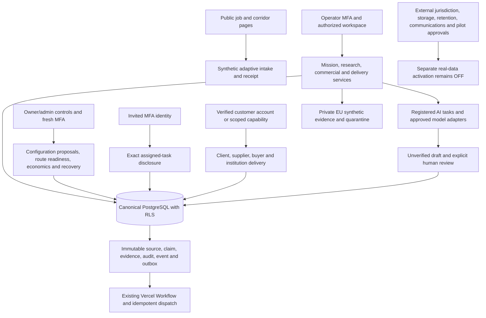

# Current Corridra V2 architecture map

The original V1 Parts 1–8 provide identity, trust, intake, research, introductions/meetings, commercial truth and scoped delivery. Revised V2 1 supplies global registries, directional packs, alternate origins, rights and separate service economics. V2 2 supplies progressive requirements, RFQs, original offers, assessments and visits. V2 3 supplies job-first and recipient experiences, programme context and agendas. V2 4 supplies governed drafts and private contributor tasks. V2 5 supplies founder administration, readiness, observed economics and accountable recovery.

Customer identity and operator TOTP remain separate. A customer account grants no tenant membership; a contributor grants no mission access; a publication grants only its pinned scope. Shared original-language evidence is distinct from translation-derived drafts. Financial currencies, provenance and compensations remain original and append-only.

No new queue, Kubernetes, Kafka, predictive model, billing processor or payout service is introduced. Configuration data creates additional registered country routes without country-specific domain forks. Adding an unsupported adapter or capability still requires an ordinary reviewed engineering release.
