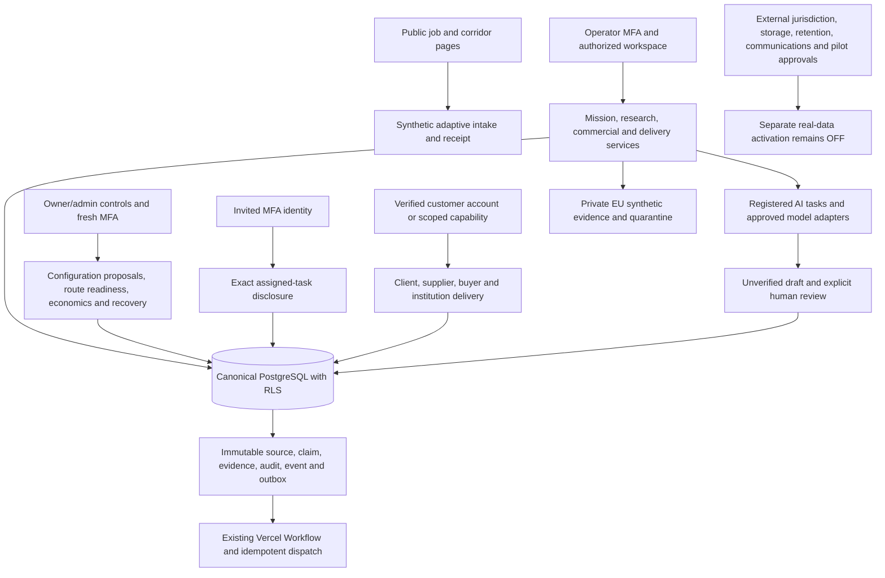

# Current Corridra V2 architecture map

The original V1 Parts 1–8 provide identity, trust, intake, research, introductions/meetings, commercial truth and scoped delivery. Revised V2 1 supplies global registries, directional packs, alternate origins, rights and separate service economics. V2 2 supplies progressive requirements, RFQs, original offers, assessments and visits. V2 3 supplies job-first and recipient experiences, programme context and agendas. V2 4 supplies governed drafts and private contributor tasks. V2 5 supplies founder administration, readiness, observed economics and accountable recovery.

Customer identity and operator TOTP remain separate. A customer account grants no tenant membership; a contributor grants no mission access; a publication grants only its pinned scope. Shared original-language evidence is distinct from translation-derived drafts. Financial currencies, provenance and compensations remain original and append-only.

No new queue, Kubernetes, Kafka, predictive model, billing processor or payout service is introduced. Configuration data creates additional registered country routes without country-specific domain forks. Adding an unsupported adapter or capability still requires an ordinary reviewed engineering release.

## Current implementation boundaries

[Start here](../START_HERE.md), [current plan](../implementation/current-plan.md) and [matrix](../implementation/implementation-matrix.json) are the developer entry. UX-01 through UX-05 plus bounded UX-06/access repairs change presentation, not domain authority. The [UX contract](../ux10x/architecture.md) retains mounted forms, closed navigation, tenant-keyed state, original amounts and permission checks.

Customer identity is Managed Neon Auth; staff use independent Better Auth plus TOTP. Explicit first-password setup is ADR 030; existing-staff email recovery and scoped member naming are ADR 031. No automatic identity linking or email-based role grant. Owner administration is People and workspace controls in `/operator`, with membership changes owner-only and last-owner/fresh-MFA guards.

There are 29 additive SQL migrations at this handoff baseline. Migration 0029 adds credential-change audit without altering original identities or recording secrets. Never rewrite deployed migration hashes or migrate during a build. `packages/db/migrations` remains SQL authority; application services use restricted roles, never management credentials.

Provider adapters and restricted network task engines are implemented, with production execution OFF. Private EU synthetic Blob/quarantine is distinct from accepted real evidence infrastructure. Real operations and the original full customer commercial production acceptance remain separately gated; implemented controls are not external approval.
