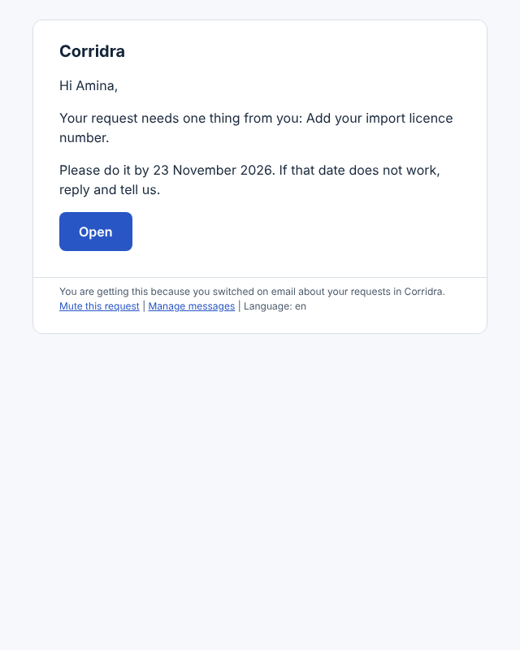
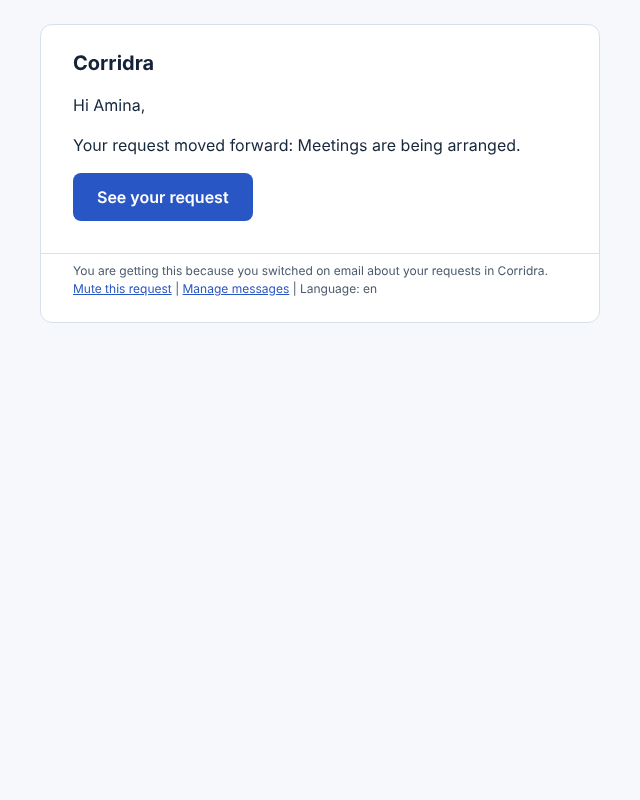
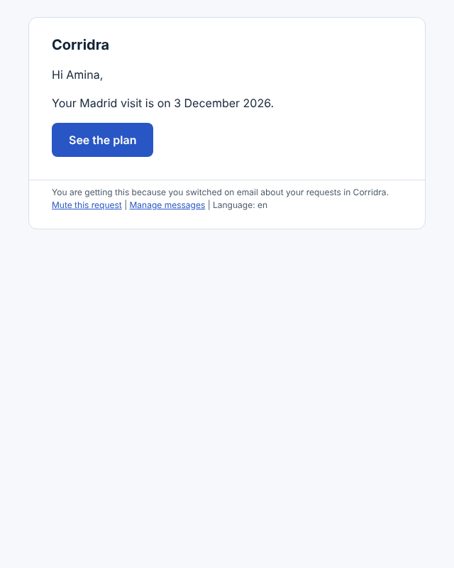
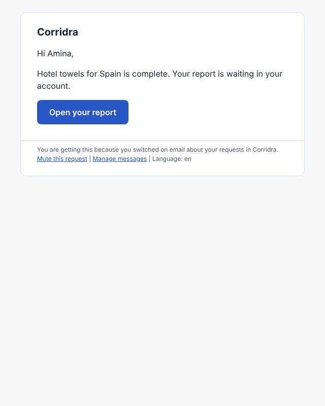
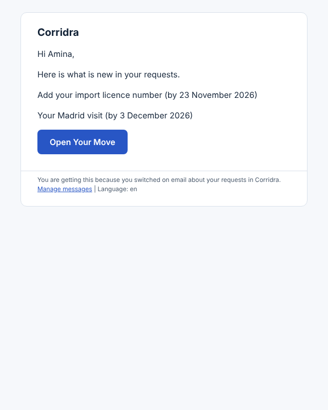

# Pulse email: review pack for the owner

Written 25 October 2026. Pulse is built and closed. Nothing is sent to anyone until it is opened (steps at the end). The engineering privacy review you asked me to do is recorded in [pulse-privacy-review-2026-10-25.md](pulse-privacy-review-2026-10-25.md): it found three blockers, two are fixed and one is a check only you can do (the replies mailbox). This pack is a plain description of what the system does after those fixes. It is not legal advice; the privacy lawyer review of the notice is still a separate later step.

## What you are deciding

| #   | What only you can confirm                                                                                                           | Why                                                                                                                  |
| --- | ----------------------------------------------------------------------------------------------------------------------------------- | -------------------------------------------------------------------------------------------------------------------- |
| 1   | The replies mailbox (`CUSTOMER_AUTH_MAIL_REPLY_TO`) is read by a person.                                                            | Message 1 says "reply and tell us". The value is encrypted in Vercel, so I cannot read it. Mission mail uses it too. |
| 2   | In the Resend account: how long delivery records are kept and where, and that the notice matches.                                   | Resend keeps its own record of each email (address and content). The notice says so; I cannot see the account.       |
| 3   | You are comfortable that message records (a verb and the team's short words, a date, a status) are kept with no automatic deletion. | Disclosed in the notice. A deletion process needs its own design with the privacy lawyer.                            |

Everything else in the review is fixed or accepted, with the reason, in the review record.

## Who is emailed, and when

- Only the verified account holder who owns the request, at the verified address on their account. Never a teammate, a supplier, a buyer or an address typed by anyone. The greeting uses the name on their account.
- Only if that person switched email on. Email is off for everyone until they do (Email choices page). Each person is told: the page leads with the switch, and Your Move and the request page show an "Email is off" prompt until they choose.
- Never for a request they muted, never for a kind they switched off, never after the thing it is about is done or cleared, never from a sample workspace.
- At most three messages a day for one request and ten a day for one person. Quiet hours and the daily email only delay a message; it stays valid for 24 hours after it can first be sent, and then it expires unsent.

## The messages (rendered with sample data)

Every email is a single column with a plain-text twin and no open-tracking pixel. The body has the name on the person's account, a short description written by the Corridra team (a verb from a fixed list plus up to 80 plain characters, a run of seven or more digits is refused) and a date. A subject never carries the team's words, so nothing from the team shows on a lock screen. The Move screen warns staff that these words are emailed and kept. No price, supplier field or file is ever read into an email.

### 1. One thing needs you

The only message that can be sent today. The Corridra team sets a Move that the person must do; the person is emailed once.



Plain text:

```text
Subject: One thing needs you

Hi Amina,

Your request needs one thing from you: Add your import licence number.

Please do it by 23 November 2026. If that date does not work, reply and tell us.

Open: https://c.obsidianglobal.studio/account/requests/6f1d3a52-8c1e-4b3a-9d7e-2f4a5b6c7d8e

You are getting this because you switched on email about your requests in Corridra.
Mute this request: https://c.obsidianglobal.studio/pulse/mute/6f1d3a52-8c1e-4b3a-9d7e-2f4a5b6c7d8e#t=SAMPLE-TOKEN-NOT-REAL
Manage messages: https://c.obsidianglobal.studio/account/notifications
Language: en
```

### 2. Your request moved forward

Text and template exist. Nothing triggers it yet (see "What is not built").



Plain text:

```text
Subject: Your request moved forward

Hi Amina,

Your request moved forward: Meetings are being arranged.

See your request: https://c.obsidianglobal.studio/account/requests/6f1d3a52-8c1e-4b3a-9d7e-2f4a5b6c7d8e

You are getting this because you switched on email about your requests in Corridra.
Mute this request: https://c.obsidianglobal.studio/pulse/mute/6f1d3a52-8c1e-4b3a-9d7e-2f4a5b6c7d8e#t=SAMPLE-TOKEN-NOT-REAL
Manage messages: https://c.obsidianglobal.studio/account/notifications
Language: en
```

### 3. A date is coming up

Text and template exist. Nothing triggers it yet.



Plain text:

```text
Subject: A date is coming up

Hi Amina,

Your Madrid visit is on 3 December 2026.

See the plan: https://c.obsidianglobal.studio/account/requests/6f1d3a52-8c1e-4b3a-9d7e-2f4a5b6c7d8e

You are getting this because you switched on email about your requests in Corridra.
Mute this request: https://c.obsidianglobal.studio/pulse/mute/6f1d3a52-8c1e-4b3a-9d7e-2f4a5b6c7d8e#t=SAMPLE-TOKEN-NOT-REAL
Manage messages: https://c.obsidianglobal.studio/account/notifications
Language: en
```

### 4. Your mission is complete

Text and template exist. Nothing triggers it yet.



Plain text:

```text
Subject: Your mission is complete

Hi Amina,

Hotel towels for Spain is complete. Your report is waiting in your account.

Open your report: https://c.obsidianglobal.studio/account/requests/6f1d3a52-8c1e-4b3a-9d7e-2f4a5b6c7d8e

You are getting this because you switched on email about your requests in Corridra.
Mute this request: https://c.obsidianglobal.studio/pulse/mute/6f1d3a52-8c1e-4b3a-9d7e-2f4a5b6c7d8e#t=SAMPLE-TOKEN-NOT-REAL
Manage messages: https://c.obsidianglobal.studio/account/notifications
Language: en
```

### 5. The daily email

Sent instead of single messages when the person chose "one email a day". It gathers what is due into one message at 08:00 in their time zone. It has no mute link, even when it holds one request; it has Manage messages, where the daily email or all email can be switched off.



Plain text:

```text
Subject: What is waiting for you

Hi Amina,

Here is what is new in your requests.

Add your import licence number (by 23 November 2026)

Your Madrid visit (by 3 December 2026)

Open Your Move: https://c.obsidianglobal.studio/account/move

You are getting this because you switched on email about your requests in Corridra.
Manage messages: https://c.obsidianglobal.studio/account/notifications
Language: en
```

The words come from `packages/auth/src/pulse-templates.ts`. English only: a person who picks another email language still gets English, and the Email choices page says so. The sample address, name and mute token above are made up.

## What is kept, and where

| Item            | What it holds                                                                                                                                                                                                                                                                                      | How long                                                                                                                                      |
| --------------- | -------------------------------------------------------------------------------------------------------------------------------------------------------------------------------------------------------------------------------------------------------------------------------------------------- | --------------------------------------------------------------------------------------------------------------------------------------------- |
| Email choices   | Which messages, daily email, quiet hours, time zone, language, and the time each choice was saved. Saving at least one kind is the opt-in; saving none is the opt-out.                                                                                                                             | Every version is kept (append only). This is the record of consent. It carries the time of each choice but not the notice version shown.      |
| Message record  | Request id, person id, kind, the team's Move words (verb plus up to 80 characters), a date, status, times, and digests of two tokens. Never an address or a name. The words are staff-written, so they are warned on screen and a long number is refused.                                          | Kept as history (append only, never deleted). A message that cannot be sent within 24 hours of becoming due is marked expired; the row stays. |
| Mute record     | The request id only.                                                                                                                                                                                                                                                                               | Kept.                                                                                                                                         |
| Activity events | Ids and the kind only.                                                                                                                                                                                                                                                                             | Kept with the other audit events.                                                                                                             |
| The address     | Read from the sign-in account (`neon_auth.user`, verified addresses only) inside the database at the moment of sending, held in memory for that one send, and handed to the mail provider (Resend, the same one used for sign-in and mission emails) together with the name and the email content. | Not written to any Corridra table or log. Resend keeps its own delivery record for a limited time under its terms.                            |

## What is not built

- Messages 2, 3 and 4 (a request moved forward, a date is close, a mission closed) have texts but no trigger. They wait for the phase 2 interviews. Only message 1, and the daily email that gathers message 1 items, can go out today.
- Email in other languages (needs a reviewed translation).
- Deleting a person's choices or message records on request. The records are append only by design; an erasure process for them is not designed yet and belongs with the privacy lawyer review.
- Web push and WhatsApp (outside ADR-067).

## Privacy notice wording (appears only while Pulse is on)

The privacy page (dated 25 October 2026) gains a purposes line, a processors line, a storage line and this paragraph. All of it is hidden while Pulse is off, so the notice and the feature open in the same deploy.

> Email about your requests is off until you switch it on, on the Email choices page. You can switch it off there at any time, or mute one request from the link in an email. If you switch it on, we email the verified address on your account when the Corridra team sets something you need to do, or once a day if you choose. When we send, we read your name and verified address from your account and pass them to Resend, which delivers the email, with sending configured in Ireland. Resend keeps its own delivery record, including the address and the content, for a limited time under its terms. Our email records do not hold your address. Each email contains your name, a short description of what is needed as written by our team, a date if there is one, a link to the request or to Your Move, and a link to your email choices. Emails sent one at a time about a request also have a link to mute that request; the daily email has none, and you can switch it off on the Email choices page. We keep each version of your email choices with its time, as the record of your consent, and a record of each message (which request, its description, date and status, never your address) in the Frankfurt application database. These records are not deleted automatically; contact us to have them reviewed. Basis: your consent.

## Opening Pulse, and undoing it

1. Run the `install-customer-modules` job with `notifications_action = enable`, `apply = yes` and a reason of at least ten characters. You approve it in the protected environment. It applies the new migration, checks that the database owner can read the sign-in provider's user table (and stops with a plain message if not), and opens the database control.
2. Set `CORRIDRA_PULSE_ENABLED=true` in Vercel production and redeploy. Real use must be on (it is).
3. People then see the "Email is off" prompt. Nobody is emailed until they switch email on.

To undo: run the job with `notifications_action = pause` (stops new work at once; every record is kept), or remove `CORRIDRA_PULSE_ENABLED` and redeploy.

Not observed: whether the production database owner can read the sign-in provider's user table. Step 1 reports it and refuses to open if it cannot, so nothing is opened in a state that cannot send.
