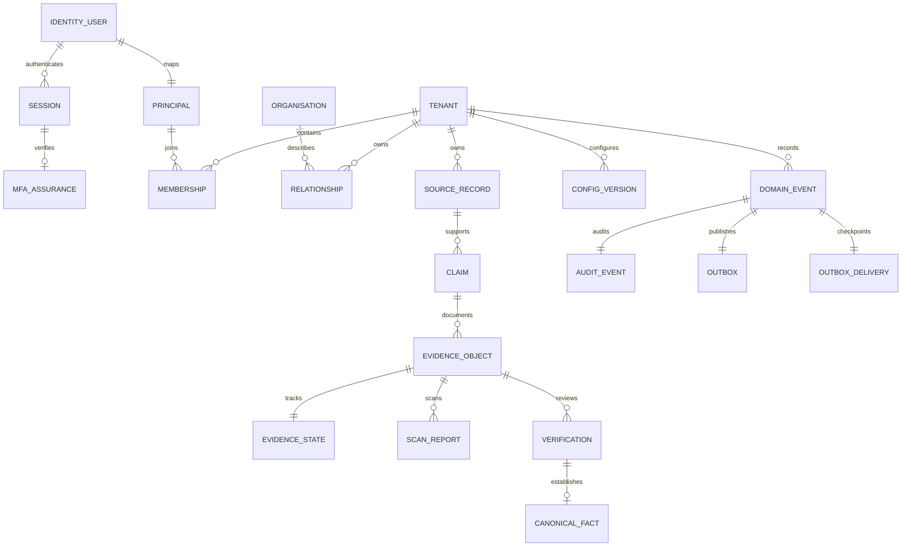

# Part 03 security contracts

Scope: synthetic operator preview. Read ADRs 002 to 005, 010 and 012 and the release record before enabling infrastructure.

## Permissions

All rows below also require an active server-side session, enrolled TOTP, current assurance, active principal and tenant membership, selected tenant, approved purpose, classification and operating country. Membership is checked on every command. API flags cannot grant database access.

| Action                                           | Owner                 | Admin | Operator | Reviewer | Viewer | Additional condition                                                                   |
| ------------------------------------------------ | --------------------- | ----- | -------- | -------- | ------ | -------------------------------------------------------------------------------------- |
| Read allowed source, claim and evidence metadata | Yes                   | Yes   | Yes      | Yes      | Yes    | RLS and policy attributes                                                              |
| Create source, claim, upload, scan               | Yes                   | Yes   | Yes      | Yes      | No     | Upload flag and configured private adapters                                            |
| Verify or reject reviewed evidence               | Yes                   | Yes   | No       | Yes      | No     | Different person from uploader; clean scan; MFA within five minutes; verification flag |
| Download evidence                                | Yes                   | Yes   | Yes      | Yes      | Yes    | Clean, under review or verified, unexpired retention, matching hash                    |
| View member list and event audit                 | Yes                   | Yes   | No       | No       | No     | Tenant-scoped RLS                                                                      |
| Change existing membership                       | Yes                   | No    | No       | No       | No     | Fresh MFA; serialized change; keep one active owner                                    |
| Append configuration version                     | Yes                   | No    | No       | No       | No     | Fresh MFA; allowed flag key; serialized version                                        |
| Provision identities or tenants                  | Offline administrator | No    | No       | No       | No     | Schema-owner job; explicit service actor; no web endpoint                              |
| Read credentials or become a table owner         | No runtime role       | No    | No       | No       | No     | Separate identity and migration trust boundaries                                       |

Default flags are off. Supported keys are `evidence.uploads` and `evidence.verification`. The application never invokes an AI provider. AI policy is recorded, with `DENY` in the operator UI and synthetic seed.

## Initial ERD

Every trust relationship uses tenant-composite foreign keys. Principal and global organisation IDs are global. The distinction permits a shared public entity without sharing relationship notes. `identity.security_event` is a separate immutable session/MFA audit. Only factual country/corridor primitives are seeded in migrations.

## Event catalogue

All tenant types use envelope schema version 1. Table names deliberately match migration identifiers.

| Event types                                      | Aggregate and version                            | Meaning                                    |
| ------------------------------------------------ | ------------------------------------------------ | ------------------------------------------ |
| `membership.insert`, `membership.update`         | Principal ID within tenant; incrementing version | Membership/role/revocation changed         |
| `relationship.insert`, `relationship.update`     | Relationship UUID; incrementing version          | Private entity relationship changed        |
| `source_record.insert`                           | Source UUID; 1                                   | Provenance recorded                        |
| `claim.insert`                                   | Claim UUID; 1                                    | Self-declared statement recorded           |
| `evidence_object.insert`                         | Evidence UUID; 1                                 | Immutable private object metadata recorded |
| `evidence_state.insert`, `evidence_state.update` | Evidence UUID; incrementing version              | Quarantine or review state changed         |
| `scan_report.insert`                             | Scan UUID; 1                                     | Scanner outcome recorded, including errors |
| `verification.insert`                            | Review UUID; 1                                   | Scoped human decision recorded             |
| `canonical_fact.insert`                          | Fact UUID; 1                                     | Reviewed claim accepted as a fact          |
| `config_version.insert`                          | Configuration key; incrementing version          | Effective feature/configuration appended   |

Identity audit actions: `session.insert`, `session.delete`, `mfa.enabled`, `mfa.disabled`. No domain event payload carries passwords, session tokens, source text or uploaded bytes. The default causation ID starts a new command; callers can preserve an upstream causation ID through the internal service context. No external consumer or dispatcher is enabled in this milestone.

## Threat model

| Threat and trust boundary                      | Enforced mitigation                                                                  | Evidence or remaining gate                                                                                   |
| ---------------------------------------------- | ------------------------------------------------------------------------------------ | ------------------------------------------------------------------------------------------------------------ |
| Guessed tenant/record IDs from browser         | Service authorization, selected-tenant RLS and composite references                  | Restricted PostgreSQL and browser denial tests                                                               |
| Session cookie without MFA or after revocation | Server lookup plus database MFA assurance, immediate membership/session denial       | Real provider enrollment/signout tests; negative RLS tests                                                   |
| Forged actor or leaked connection context      | Token hash resolved in private schema; transaction-local settings                    | Runtime cannot read tokens/switch roles; combined-role and privilege rejection; single-connection reuse test |
| Privilege abuse by ordinary operator           | Permission matrix, fresh MFA and independent reviewer                                | Role and step-up denial tests; last-owner service guard                                                      |
| Cross-site commands                            | Exact Origin check on all POSTs and SameSite cookies                                 | Provider/API browser tests                                                                                   |
| Concurrent reviews/configuration               | Row locks, advisory locks, state versions and immutable history                      | Concurrent config version test; state transition tests                                                       |
| Malware, spoofed MIME, oversized upload        | Stream bounds, signatures, SHA-256, private quarantine and fail-closed scanner       | Actual ClamAV EICAR test, MIME/size/tamper tests; cloud scanner pending                                      |
| Forged or weakened evidence                    | Inherited policy, immutable provenance and exact verified claim                      | SQL downgrade denial and independent-review checks                                                           |
| Partial business/event write                   | Transactional database triggers                                                      | Forced rollback and event/audit/outbox reconciliation                                                        |
| Cloud preview accidentally accesses production | Separate-project/parent guards, explicit runtime URLs, production activation refusal | Live isolation is blocked until account scopes are corrected                                                 |
| Lost database or object                        | Backup and versioned private object policy                                           | Local restricted-role restore passed; Neon PITR/AWS recovery pending                                         |
| Compromised schema owner or app server         | Offline migration secret; runtime privileges; scoped secrets                         | These remain trusted boundaries. Secret rotation and deployment access require account controls              |
| International access or legal misuse           | Purpose/country/classification controls; synthetic-only admission                    | Counsel and contractual review required before personal data                                                 |

Residual limits: bundled local antivirus signatures are not a managed production update service; TOTP is not phishing-resistant passkey authentication; recorded operating country is not geolocation proof; application server compromise can abuse the identity database role. Global anti-abuse controls and recovery staffing are required before a real pilot. No claim of independent penetration testing or production compliance is made.

Dependency policy: the workspace pins esbuild 0.28.1 through an override to close GHSA-67mh-4wv8-2f99 and GHSA-g7r4-m6w7-qqqr across tooling dependencies. Revalidate transformation/build/browser behavior when changing that override. No development server from esbuild is exposed.
